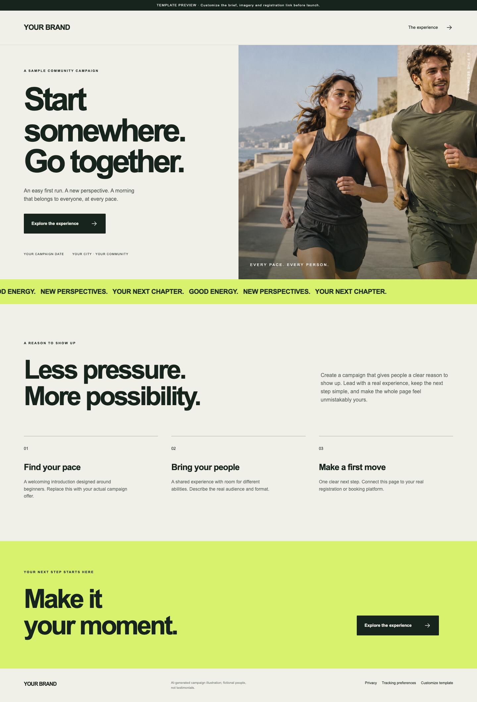

# Campaign Landing Page Builder

Turn a campaign brief into an editorial, mobile-ready landing page with motion, original AI imagery, UTM links and consent-controlled measurement.

One click opens the workspace; it does not connect accounts or publish a campaign. Python 3.10+ is sufficient. Start with `python3 -m http.server 8000 --bind 127.0.0.1`, then open `http://localhost:8000/builder.html` to fill and download your Markdown brief. Open `index.html` to preview the sample.

Give `MASTER_PROMPT.md` and your brief to a tool-capable AI host. Upload brand guidelines or supply your brand website and permission to derive a palette. The agent must ask for missing campaign details before generating or publishing.

## Included

- Brief form that downloads Markdown; editable JSON campaign configuration.
- Responsive editorial layout, SVG controls, reveal motion and reduced-motion support.
- An original AI-generated sample photograph of fictional adults; no client assets or logos.
- UTM propagation to your real conversion URL. No fabricated form submissions.
- Optional GA4 and Meta tracking, disabled until the visitor opts in. Other platforms require implementation and testing by your agent.
- A dependency-free validator/exporter: `python3 build.py --config campaign.json`. Upload the resulting `dist/` to your chosen static host.

Before launch replace the sample offer, dates, CTA and privacy URL, verify the registration integration, and set `demo` to false only when the campaign is real. `example.com` links are placeholders. Never claim a demo CTA creates a registration.

Tests: `python3 -m unittest -v`. The export is static; form processing, CRM destinations and tracking account setup remain operator-specific. No hosting account is bundled. Read [the operating prompt](MASTER_PROMPT.md), [the brief](CAMPAIGN_BRIEF.md) and [quality checks](QUALITY_CHECKS.md).

## Sample preview

